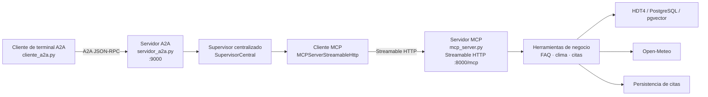

# Hoja de Trabajo 7 - Protocolos agénticos

Sistema conversacional de Parachute S.A. expuesto como un único agente remoto mediante A2A, con herramientas de negocio agrupadas en un servidor MCP.

## Miembro del equipo

- Marcelo Detlefsen - 24554

Esta HDT se trabajó individualmente. Consideramos que los temas de protocolos agénticos eran especialmente didácticos y que resultaba más provechoso que cada integrante desarrollara su propia implementación.

## Objetivo de HDT7

HDT7 integra la arquitectura centralizada validada previamente con dos protocolos agénticos:

- MCP expone las capacidades de FAQ, clima y calendarización mediante Streamable HTTP.
- A2A expone el supervisor central como un único agente remoto.
- La terminal funciona como cliente A2A y no ejecuta herramientas locales.

La lógica de negocio continúa en `shared/parachute.py`, incluyendo reglas meteorológicas, consulta a Open-Meteo, persistencia de citas e integración con HDT4.

## Dependencias y versiones

El entorno utilizado para HDT7 contiene:

- Python 3.10 o superior.
- `openai-agents==0.24.0`.
- `mcp==2.3.0`.
- `a2a-sdk==1.2.2`.
- `a2a-sdk[http-server]` para las rutas HTTP del servidor A2A.
- `uvicorn`, `httpx`, `python-dotenv` y `psycopg2-binary`.

La dependencia A2A está fijada en `requirements.txt`. Las credenciales deben configurarse mediante `.env`; no se deben subir API keys.

### Crear y activar el entorno virtual

Desde la raíz del repositorio:

```bash
python3 -m venv .venv
source .venv/bin/activate
python -m pip install --upgrade pip
pip install -r requirements.txt
```

Para verificar que se está utilizando el entorno correcto:

```bash
which python
python --version
python -m pip list
```

En Windows PowerShell, la activación equivalente es:

```powershell
python -m venv .venv
.\.venv\Scripts\Activate.ps1
python -m pip install --upgrade pip
pip install -r requirements.txt
```

## Arquitectura HDT7



El servidor A2A publica una sola Agent Card. Los workers `WeatherWorker`, `FAQWorker` y `CalendarWorker` permanecen internos al supervisor y no se publican como agentes A2A independientes.

## Servidor MCP

`mcp_server.py` utiliza `MCPServer` con transporte Streamable HTTP y expone `/mcp` de forma stateless. Las herramientas públicas son:

- `faq_tool(question: str)`: consulta el conocimiento de HDT4.
- `weather_tool(date: str)`: valida la fecha, consulta Open-Meteo y aplica las reglas meteorológicas.
- `schedule_tool(date: str)`: vuelve a validar el clima y persiste una cita únicamente si las condiciones son seguras.

`search_knowledge_base` continúa siendo una implementación interna de HDT4 y no es una herramienta MCP pública.

## Servidor A2A

`servidor_a2a.py` envuelve `SupervisorCentral` como un único agente remoto. La Agent Card está disponible en:

```text
http://127.0.0.1:9000/.well-known/agent-card.json
```

Sus skills son:

- preguntas frecuentes;
- consulta de clima;
- calendarización segura.

La primera versión trata cada tarea como una solicitud independiente en el servidor A2A. El cliente de terminal conserva `context_id` durante el modo interactivo cuando el servidor lo devuelve.

## Variables de entorno

```dotenv
MCP_SERVER_URL=http://127.0.0.1:8000/mcp
MCP_PORT=8000
A2A_SERVER_URL=http://127.0.0.1:9000
A2A_HOST=127.0.0.1
A2A_PORT=9000
```

También se requiere la configuración del proveedor compatible con OpenAI, por ejemplo `GROQ_API_KEY`, `GROQ_MODEL` y `GROQ_BASE_URL`, además de las variables de PostgreSQL cuando se consulta HDT4.

## Ejecución

Usando el entorno virtual del proyecto:

```bash
source .venv/bin/activate
```

Levantar el servidor MCP en una terminal:

```bash
MCP_PORT=8000 python mcp_server.py
```

Levantar el servidor A2A en otra terminal:

```bash
A2A_HOST=127.0.0.1 A2A_PORT=9000 \
MCP_SERVER_URL=http://127.0.0.1:8000/mcp \
python servidor_a2a.py
```

Iniciar el cliente de terminal en una tercera terminal:

```bash
A2A_SERVER_URL=http://127.0.0.1:9000 python cliente_a2a.py
```

Consulta única:

```bash
A2A_SERVER_URL=http://127.0.0.1:9000 \
python cliente_a2a.py "¿Cuál es el peso máximo permitido para saltar?"
```

Consultar la Agent Card:

```bash
curl http://127.0.0.1:9000/.well-known/agent-card.json
```

## Preguntas de prueba para la demostración

Estas preguntas pueden copiarse directamente en `cliente_a2a.py` durante la grabación:

### FAQ

```text
¿Cuál es el peso máximo permitido para saltar?
¿Qué requisitos se necesitan para realizar la actividad?
¿Qué equipo debe llevar el cliente?
```

### Clima

```text
¿Cómo estará el clima el 2026-10-20?
Consulta el clima para el 2026-10-21.
```

### Cita rechazada por clima

```text
Quiero calendarizar una cita el 2026-10-20.
Quiero agendar una cita para el 2026-10-21.
```

La respuesta debe mostrar `NO SEGURO / PROHIBIDO` cuando el reporte real indique condiciones inseguras. En ese caso no se debe llamar `schedule_tool` ni afirmar que la cita fue aprobada.

### Cita aprobada con fixture

```text
Quiero calendarizar una cita el 2026-10-02.
```

Para una demostración determinista de aprobación, esta pregunta debe ejecutarse utilizando el fixture de clima ideal de las pruebas MCP. No se debe asumir que Open-Meteo producirá condiciones ideales para una fecha real.

## Flujos principales

### Consulta FAQ

El cliente envía texto por A2A. El servidor A2A lo entrega a `SupervisorCentral`, que delega en `FAQWorker`. El worker invoca remotamente `faq_tool` mediante el cliente MCP. La herramienta consulta HDT4 y el resultado regresa por MCP, A2A y finalmente a la terminal.

### Solicitud de cita segura

El supervisor identifica la fecha y solicita primero `weather_tool`. Si la decisión es `IDEAL` o `MARGINAL`, puede solicitar `schedule_tool`. Esta herramienta vuelve a validar el clima y persiste la cita. La respuesta solo se considera exitosa cuando MCP confirma `scheduled: true` y se verifica una cita nueva persistida.

### Solicitud rechazada por clima

Si `weather_tool` devuelve `NO SEGURO / PROHIBIDO`, el supervisor responde con el rechazo y las razones meteorológicas. No se llama `schedule_tool` y no se persiste ninguna cita.

## Tipos de resultado

- `MCP_UNAVAILABLE`: error técnico de conexión, transporte, descubrimiento o resultado climático ausente/no interpretable.
- Rechazo meteorológico: decisión de negocio `NO SEGURO / PROHIBIDO`; MCP sí estaba disponible y la cita se rechaza por seguridad.
- `ERROR_CALENDARIZACION`: falta evidencia de `schedule_tool`, falta persistencia o existe un resultado inválido; nunca confirma una cita sin verificación.
- Resultado válido: una respuesta de negocio, como una FAQ o una cita tentativa confirmada por la herramienta y la persistencia.

## Pruebas y estado verificado

Comandos ejecutados:

```bash
python -m unittest discover -s tests -v
python -m py_compile mcp_server.py servidor_a2a.py cliente_a2a.py
```

Resultado actual:

```text
Ran 44 tests
OK (skipped=1)
```

La prueba omitida requiere levantar explícitamente un servidor MCP. También existen pruebas deterministas para herramientas MCP, Agent Card, cliente A2A, errores de conexión, estados fallidos, seguridad meteorológica, persistencia y sesiones consecutivas.

## Limitaciones conocidas

- La consulta FAQ real verificada en el entorno devolvió `No module named 'sentence_transformers'`; por ello no se pudo completar la búsqueda de HDT4 en esa ejecución. No se inventó una respuesta FAQ.
- PostgreSQL y pgvector solo participan después de cargar el modelo de embeddings. La ausencia de `sentence_transformers` impidió comprobar el corpus y la consulta vectorial en esa ejecución; no se afirma que la base de datos contenga o no el registro.
- Open-Meteo sí respondió durante la prueba real de clima y produjo decisiones meteorológicas. Sus resultados dependen de disponibilidad de red y del pronóstico de la fecha consultada.
- Groq fue utilizado durante las pruebas end-to-end y respondió HTTP 200 en la ejecución observada. Requiere API key, conectividad y disponibilidad del proveedor.
- Para demostrar una cita aprobada durante una grabación no se debe depender del pronóstico actual de Open-Meteo; deben usarse los fixtures deterministas existentes en `tests/test_mcp_server.py`.

## Antecedentes HDT5 y HDT6

Las entregas anteriores se conservan como contexto del proyecto:

- HDT5 exploró las arquitecturas centralizada, jerárquica y descentralizada.
- HDT6 seleccionó y evaluó la arquitectura centralizada con Promptfoo, incluyendo casos de FAQ, clima, seguridad y persistencia.
- Los diagramas, respuestas y reportes históricos permanecen en `diagramas/`, `respuestas_hdt5.md`, `respuestas_hdt5.pdf`, `evals/`, `reporte-evals.json` y `reporte-factuality.json` cuando están presentes en el repositorio.
